<p align="center">
  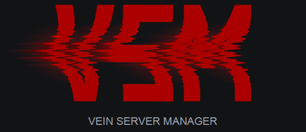
</p>

<p align="center">
  
  
  
  
  
  <a href="LICENSE"></a>
  <a href="https://ferretech.org"></a>
</p>

<!--
Live badges to add once this repository is public (shields.io cannot read a private one).
The first three also need at least one published release:

  <a href="https://github.com/Ferretech-Interactive/vsm/releases"></a>
  <a href="https://github.com/Ferretech-Interactive/vsm/releases"></a>
  
  <a href="https://github.com/Ferretech-Interactive/vsm/actions/workflows/ci.yml"></a>
  <a href="https://github.com/Ferretech-Interactive/vsm/issues"></a>
  

Then drop the fixed "Status: Beta" badge at the first stable release, and replace the fixed
License badge with https://img.shields.io/github/license/Ferretech-Interactive/vsm if wanted.
A Discord badge (https://img.shields.io/discord/<server id>) fits here once the server exists.
-->

# Vein Server Manager

A manager for [Vein](https://store.steampowered.com/app/1857950/VEIN/) dedicated servers. It installs
the server for you, keeps it running, and lets you configure everything from one window, or from a
browser on another machine.

- **A Windows program**: its own window and tray icon, installed with a normal Setup.exe. Nothing
  else to install.
- **Runs as a Windows service**: the manager and the game server start with Windows, before anyone
  logs on, under their own locked-down account.
- **Guided setup**: the first launch walks you through name, ports, mods and start-up options, then
  downloads and starts the server.
- **Manage other machines**: the same window can connect to managers running on other PCs.
- **Everything from the original desktop app (v5.1.6)**: start/stop/restart with save protection, crash watchdog,
  scheduled restarts, memory watchdog, gameplay settings, mods and a safe `Game.ini` editor, player
  history and bans, backups, config profiles, Discord webhooks and the Discord command bot.
- **New**: live console, backup download/restore, uptime-limit restarts, interval backups, admin
  SteamIDs with a Steam profile lookup, CPU / memory / network use of the game server, a health
  check that reads the game log for known problems, game server update notices, the game's own
  chat-to-Discord relay, REST API.
- **Linux and Docker** are supported as a secondary option; see [Linux and Docker](#linux-and-docker).

## Screenshots

<table>
  <tr>
    <td align="center"><a href="docs/screenshots/01-dashboard.png">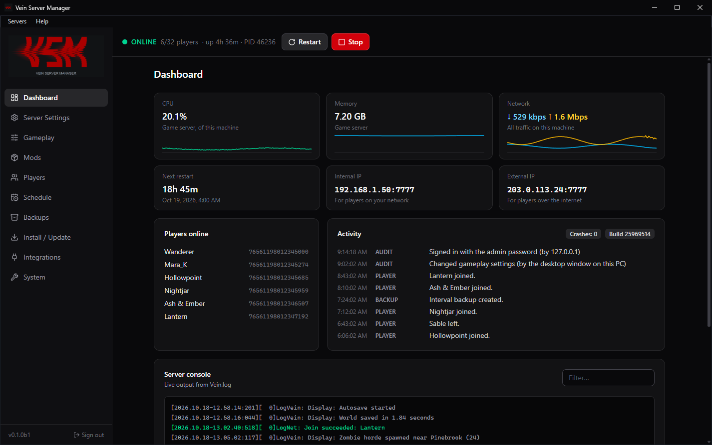</a><br><sub>Dashboard: status, resource use, players online, activity and the live console</sub></td>
    <td align="center"><a href="docs/screenshots/02-server-settings.png">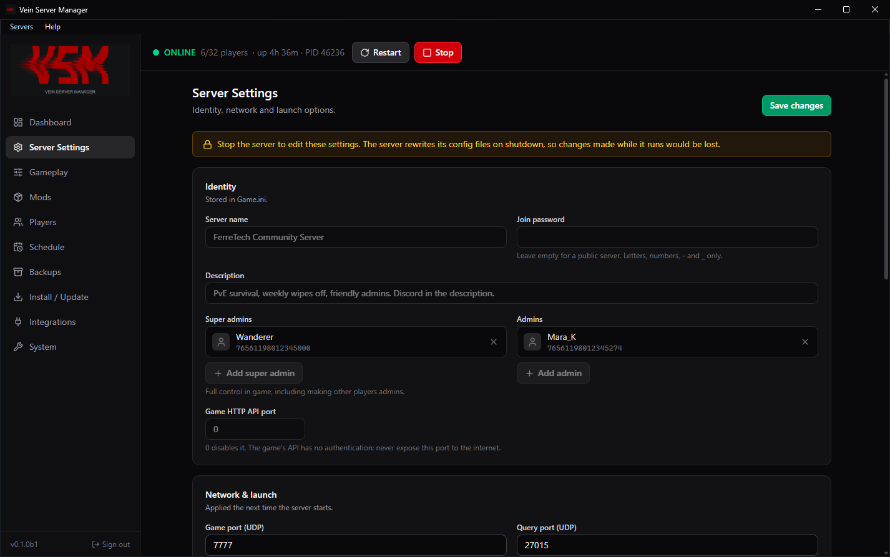</a><br><sub>Server settings</sub></td>
  </tr>
  <tr>
    <td align="center"><a href="docs/screenshots/03-gameplay.png">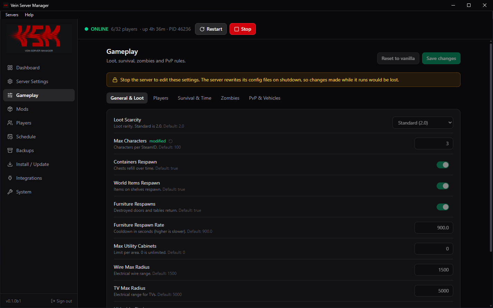</a><br><sub>Gameplay settings, with the game's defaults</sub></td>
    <td align="center"><a href="docs/screenshots/04-mods.png">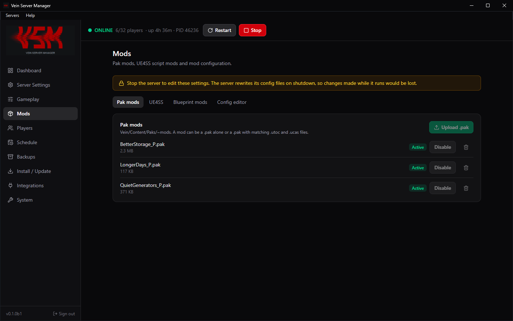</a><br><sub>Mods: pak mods, UE4SS and blueprint mods</sub></td>
  </tr>
  <tr>
    <td align="center"><a href="docs/screenshots/05-players.png">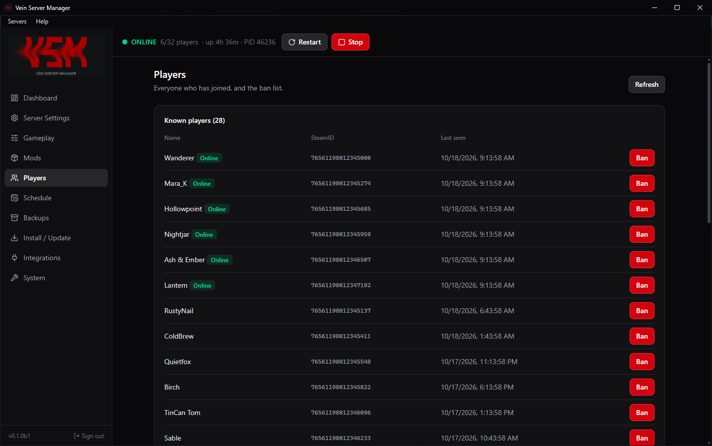</a><br><sub>Players and bans</sub></td>
    <td align="center"><a href="docs/screenshots/06-schedule.png">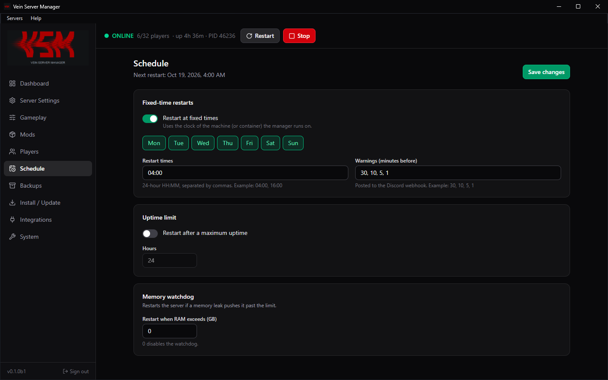</a><br><sub>Scheduled restarts</sub></td>
  </tr>
  <tr>
    <td align="center"><a href="docs/screenshots/07-backups.png">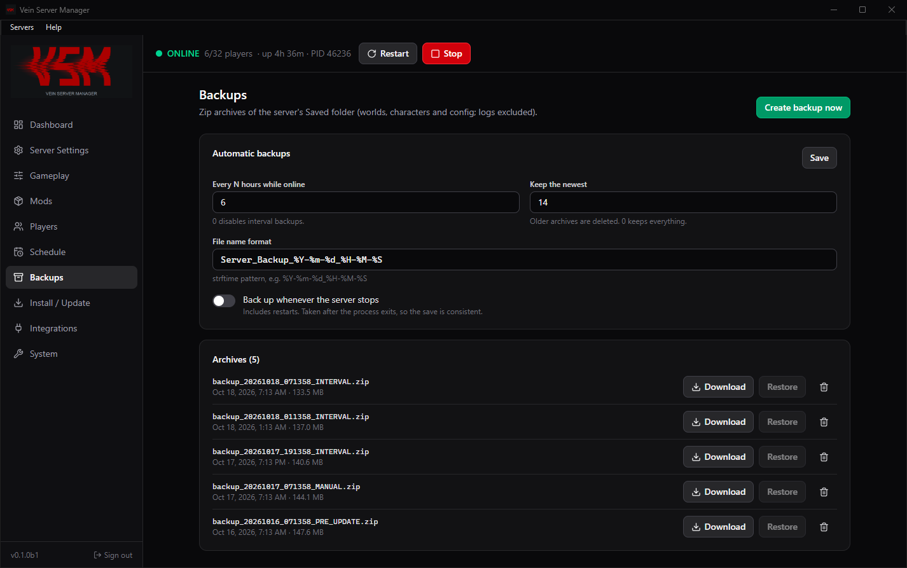</a><br><sub>Backups</sub></td>
    <td align="center"><a href="docs/screenshots/08-install-update.png">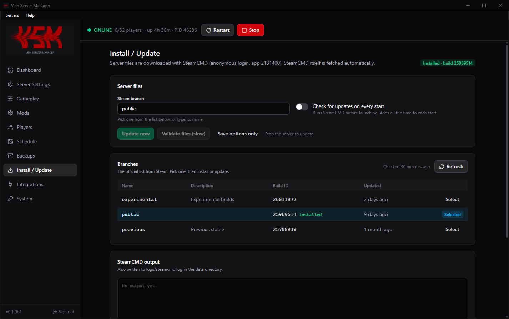</a><br><sub>Install / Update and Steam branches</sub></td>
  </tr>
  <tr>
    <td align="center"><a href="docs/screenshots/09-integrations.png">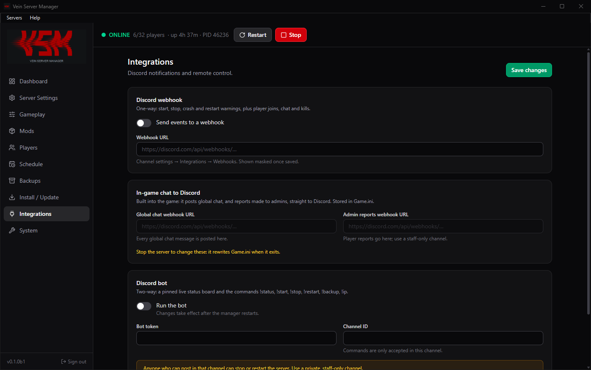</a><br><sub>Discord integrations</sub></td>
    <td align="center"><a href="docs/screenshots/10-system-health-check.png">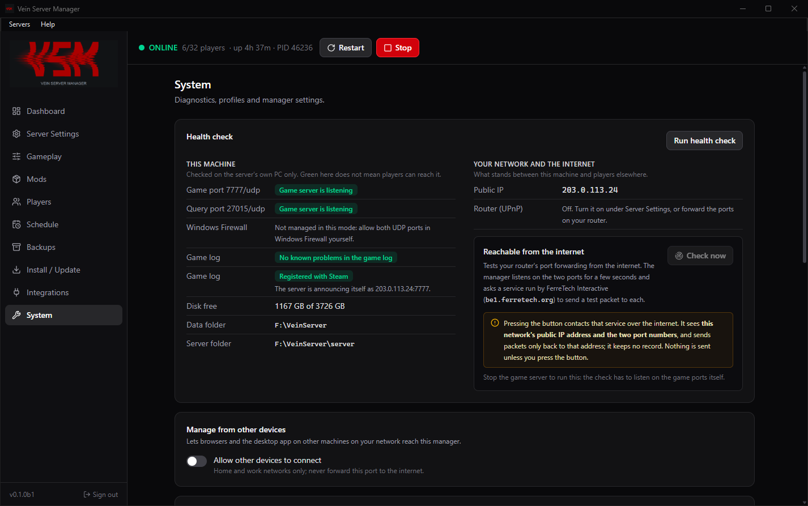</a><br><sub>Health check</sub></td>
  </tr>
  <tr>
    <td align="center"><a href="docs/screenshots/11-guided-setup.png">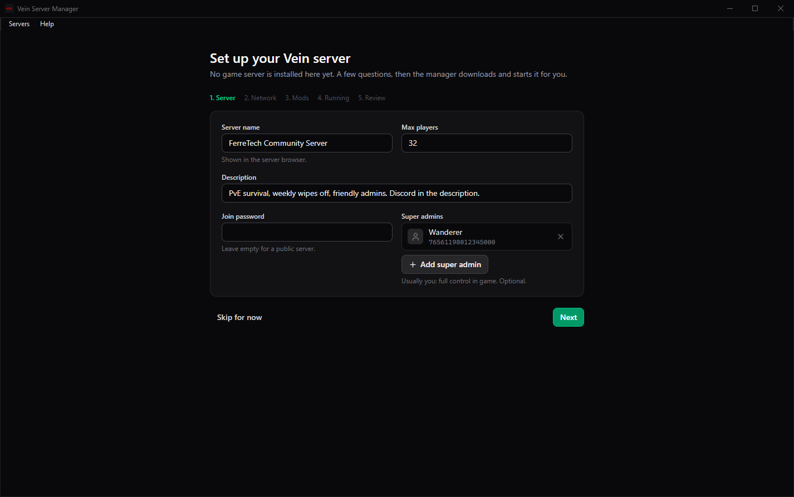</a><br><sub>Guided first-time setup</sub></td>
    <td align="center"><a href="docs/screenshots/14-deploy-to-linux.png">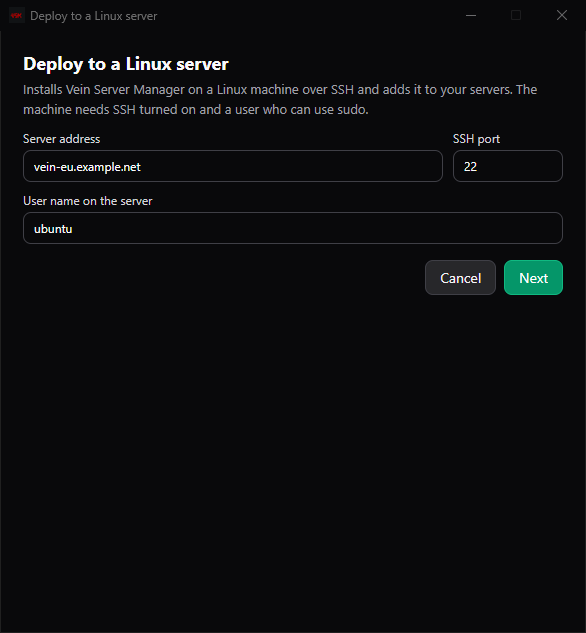</a><br><sub>Deploying to a Linux server over SSH</sub></td>
  </tr>
</table>

The screenshots use invented data: player names, SteamIDs and the public address (from the documentation range) are not real.

## Install on Windows

Windows 10, 11 or Server 2019 and later (64-bit).

1. Download **VSM &lt;version&gt; Setup.exe** from the
   [releases page](https://github.com/Ferretech-Interactive/vsm/releases). Builds marked
   **Pre-release** are betas.
2. Run it. Stable releases are signed by FerreTech Interactive LLC; if Windows shows a different
   publisher, or none, do not run the file. Betas are not signed: Windows warns about an unknown
   publisher, and you can check the download against `SHA256SUMS.txt` on the release
   (`Get-FileHash` in PowerShell).
3. Open **Vein Server Manager** from the Start menu. With no game server installed yet, it opens a
   guided setup and then downloads the server (several GB).

Or paste this into PowerShell to download and start the installer of the latest stable release:

```powershell
$a = (irm https://api.github.com/repos/Ferretech-Interactive/vsm/releases/latest).assets | ? name -like '*Setup.exe'; $f = "$env:TEMP\$($a.name)"; irm $a.browser_download_url -OutFile $f; Start-Process $f -Wait
```

Setup asks:

| Question | Notes |
| --- | --- |
| Host a server on this PC, or only connect to servers on other machines | "Only connect" installs just the window: no service, no game files |
| Where to keep server data | Default `C:\VeinServerManager`; only the manager's service and administrators can open it |
| Password for remote access (optional) | Needed for browsers and other devices. Administrators of the PC never need it for the window |
| Let other devices on my network manage this server | Off by default; needs the password |
| Create a desktop shortcut | |

Run on a PC that already has it installed, Setup offers to **update and keep the settings**
(nothing is asked again) or to change the options above.

It also installs the Visual C++ runtime (needed by the game server) and the WebView2 runtime (needed
by the window) if the machine lacks them. Uninstalling stops the game server, removes the service
and firewall rules, and keeps your data folder.

Prefer no installer? **VSM &lt;version&gt; Portable.zip** on the same page is the same program:
unzip it anywhere and run `VeinServerManager.exe`. It runs as you (not as a service), keeps its data
in a `data` folder beside the exe, and leaves Windows Firewall to you.

### How it runs

- **Service.** The manager and the game server run as the Windows service `VeinServerManager`, under
  an account of its own that cannot log in and has no rights beyond its data folder. Mods therefore
  cannot reach your documents or the rest of the PC.
- **Who can open the window.** Any administrator of the PC opens the window without a password.
  Anyone else, and every browser or other device, needs the admin password.
- **Stopping.** Stopping or upgrading the service leaves a running game server alone and picks it up
  again afterwards. Shutting Windows down stops the game server properly, waiting for a save.
  With **Start server with the manager** on, it is started again when Windows comes back, unless
  you last stopped it yourself: then it stays stopped until you start it.
- **Firewall.** Game ports are chosen in the app. Windows Firewall is kept in step automatically,
  with rules tied to one program each: the game server on the two ports you chose, the manager on
  those same ports (used only by the outside port check), and, if you allow other devices, the
  web UI on private and domain networks. The health check under **System** shows whether it matches.
- **Router.** Players outside your network also need the two UDP ports forwarded on your router.
  Turn on **Ask my router to forward the game ports (UPnP)** to have the manager do it while the
  server runs, or forward them by hand. Port 8810 is never forwarded; see [Security](#security).
  The manager looks for the router on the network adapter your internet traffic uses, and only
  believes an answer from that network's own router (the default gateway). If it reports no
  router, the message says where it looked; a VPN that takes all traffic, or a second
  connection, can send it the wrong way. In that case pick the adapter yourself, in the guided
  setup's Network step or under **Server Settings > Router port forwarding**; both look for the
  router as soon as the option is turned on and show what answered. With a chosen adapter the
  manager uses whichever UPnP device answers on that adapter's network and tells you which
  device it was. Looking never changes the router: ports are only forwarded while the server runs.

### Guided setup

When no game server is installed, the manager opens a step-by-step setup: server name and player
limit, game ports, router forwarding, managing from other devices, UE4SS, start-up and backup
options. **Install** then saves the settings, downloads the server, sets up the firewall and starts
it. Each step, the choices made (never passwords) and any failure are recorded under **System >
Event log** and in `logs/manager.log`; everything SteamCMD prints goes to `logs/steamcmd.log`.
The work runs in the service, so you can close the window while it downloads. "Skip for now"
closes it until the app is next opened; **System > Run setup again** opens it at any time.

### Checking port forwarding (optional)

The Network step of the guided setup, and the health check under **System**, have a **Check now**
button that tests, from the internet, whether players can reach the two game ports. It is never run unless you press it. When you do,
the manager listens on the two ports for a few seconds and asks a
[Port Probe Service](https://github.com/Ferretech-Interactive/Port-Probe-Service) run by
FerreTech Interactive (`be1.ferretech.org`) to send a test packet to each. That service sees your
network's public IP address and the two port numbers, sends packets only back to that address,
and keeps no record. The game server must be stopped for the check, and the ports shown are
saved first.

To use a probe you host yourself, or none, set `network.probe_url` in `config.json` (or the
`VSM_PROBE_URL` environment variable) to its `https://` address, or to an empty string to remove
the button.

### Other servers

**Servers > Manage servers** (window menu or tray icon) keeps a list of managers on other machines.
Add one by name and address (`192.168.1.20`, `vein.example.com:9000`, or an `https://` address),
then **Connect** and sign in with that server's admin password. Only names and addresses are saved,
per Windows user. The remote machine must have **Allow other devices to connect** turned on (System
page, or the Setup option) and a password set. An `http://` address outside your own network is
flagged, because the password would travel unencrypted; use `https://` behind a reverse proxy, or a VPN.

### Deploying to a Linux server from the app

**Servers > Deploy to a Linux server** installs the manager on a Linux machine over SSH and adds it
to your list. The machine needs SSH turned on and a user who can use sudo (or root).

1. Enter the server's address and user name. The app shows the server's **host key fingerprint**
   before anything else; confirm it is your server.
2. Sign in with a password, a private key file or the Windows SSH agent. Nothing typed here is
   saved; it is used for this installation only.
3. The app looks at the server and offers a **service** install, a **Docker** install, or the
   reason one is not possible (see [Supported Linux versions](#supported-linux-versions)).
4. It uploads the Linux package it carries (the same version as the app; nothing is downloaded
   from GitHub), runs the installer and shows its output. The admin password it generated is
   shown once at the end, and the window signs in with it.

A server deployed this way is **reached through SSH only**. Its manager listens on the server's
own loopback address, and the app opens an SSH tunnel to it whenever you connect; the web UI is
not exposed on the network at all. Only SSH and the two game ports face outward. To use it from
a browser, or from another PC, deploy from that PC too (it gets its own key) or forward the port
yourself: `ssh -L 8810:127.0.0.1:8810 user@server`, then open `http://localhost:8810`.

Running it again on a server that already has the manager **updates it** to the app's version and
keeps its data and password. Note that this also switches a server installed by hand to
SSH-only access. **Remove** in the Servers window only makes the app forget the server and its
key; the manager stays installed.

### Updates

**The manager.** It checks GitHub for a newer release and shows a notice at the top of the window
when one exists. Nothing is downloaded without you asking. In the installed Windows app, clicking
that notice (or **Help > Check for updates**, also in the tray menu) asks first, then downloads the
new Setup.exe, checks that it is signed by FerreTech Interactive LLC, and installs it over the existing
one after the Windows administrator prompt; the game server keeps running and the window reopens.
A download that is unsigned or signed by anyone else is not run, so betas are updated by hand:
run the new Setup.exe yourself and choose to update. Beta builds are only offered if you turn on
**Include beta versions** under Server Settings, or are already running one.

**The manager on Linux and Docker.** The same notice is a button there too, in a browser or in the
Windows app connected to that server. The manager downloads the release's package from GitHub,
checks it against the release's `SHA256SUMS.txt`, installs it beside the running version (under
`manager/` in the data folder) and restarts itself in place. **The game server keeps running and
players stay connected**, and you stay signed in. A version that fails to start is abandoned on
the next start in favour of the last one that worked. This updates the manager program only; a
release that needs changes to the host or the container image will say so, and re-running the
install script (or pulling the new image) always brings everything up to date.

**The game server.** The manager also asks Steam whether the branch you chose has a newer build
than the one installed, shows a notice, and posts to Discord if that is set up. Install it from
**Install / Update**. With **Install game updates when nobody is online** turned on, it stops, updates
and restarts the server by itself, but only while the server is online with nobody on it.

Both checks run every 6 hours by default; **Check for updates every** under Server Settings
takes 10 minutes to 24 hours, and each check can be switched off there.

### Health check

**System > Run health check** looks at two things separately:

- **This machine**: whether the game server is listening on its two ports (or which other program
  holds them), whether Windows Firewall matches, disk space, and known problems in the game log,
  such as a missing Steam library, a failed heartbeat, or whether the server has registered with
  Steam. Green here only means the PC itself is in order.
- **Your network and the internet**: your public address, router forwarding (UPnP), and the
  outside port check described above.

### Reporting a problem

**System > Report a problem** (in the app also **Help > Report a problem...**) downloads a
diagnostics zip to attach to a [bug report](https://github.com/Ferretech-Interactive/vsm/issues/new/choose),
and opens the report form with the version, install type and operating system filled in. The
manager sends nothing anywhere itself.

The zip holds a summary, the health check, the settings, the Event log, the most recent part of
the manager, SteamCMD, game and UE4SS logs, `Game.ini`/`Engine.ini` and the mod list. From the app's
menu it also holds the app's own `desktop.log`. Passwords, tokens and Discord webhook URLs are
always removed; **Hide who and where** (on by default) also replaces public IP addresses,
SteamIDs, player names and the user name with placeholders. Never included: the password file,
sign-in sessions, keys, saves and backups.

### Mods

The **Mods** page handles every kind of Vein server mod. Mods can only be changed while the server
is stopped.

| Tab | What it manages | Where it lives |
| --- | --- | --- |
| Pak mods | `.pak` files (with `.utoc`/`.ucas` if the mod ships them) | `Vein\Content\Paks\~mods` |
| UE4SS | The UE4SS framework, and Lua / C++ script mods with their load order | `Vein\Binaries\Win64\ue4ss` |
| Blueprint mods | `.pak` blueprint mods loaded by UE4SS | `Vein\Content\Paks\LogicMods` |
| Config editor | Mod sections of `Game.ini` | |

**UE4SS** (Windows only) is what script mods need. *Install UE4SS* downloads the official
experimental build from the [UE4SS project](https://github.com/UE4SS-RE/RE-UE4SS), which is the one
Vein requires, together with UE4SS's own Vein-specific settings (without those the server crashes as
it finishes loading), and configures it for a machine with no desktop. A community package such as
"UE4SS Prepackaged for VEIN" can be installed from its zip instead.

- Upload a script mod as the `.zip` it was distributed in; the manager finds the mod inside it.
- **Load UE4SS when the server starts** is a safe-mode switch: turn it off to start the server
  without any script or blueprint mods when a mod is crashing it.
- Game updates often break UE4SS. The page warns when the game build has changed since UE4SS was
  installed; use *Update to latest*.
- Script and C++ mods run code on your machine with the server's permissions. Only install mods you
  trust. Many mods also have to be installed by every player.

### Unattended install

```powershell
& "VSM 0.1.0 Setup.exe" /VERYSILENT /DATADIR="D:\Vein" /PASSWORDFILE="C:\secret.txt" /TASKS="remote"
& "VSM 0.1.0 Setup.exe" /VERYSILENT /MODE=client
```

Run silently over an existing install with none of `/MODE`, `/DATADIR`, `/PASSWORDFILE` or `/TASKS`,
Setup updates the program and keeps every setting.

`/PASSWORDFILE` names a text file holding the admin password; it is read once and never appears on
a command line or in the install log (delete the file afterwards). The same command works
through PowerShell remoting or SSH, as long as that session is an elevated administrator. Then browse to
`http://<machine>:8810` from another device and complete the guided setup there.

## Linux and Docker

The manager also runs on Linux, in Docker or as a systemd service, and is used from a browser.
**Script mods that need UE4SS do not work there**: UE4SS only loads into the Windows server build.
Pak mods work on both.

### Supported Linux versions

64-bit x86 only (the Vein server and SteamCMD do not run on ARM).

**As a service (`--native`)**: needs systemd and Python 3.11 or newer as `python3`.

| Distribution | Service install |
| --- | --- |
| Ubuntu 24.04 | Yes |
| Debian 12, Debian 13 | Yes |
| Fedora 44 | Yes |
| Arch Linux | The manager installs and runs, but you must enable `[multilib]` and install `lib32-gcc-libs` yourself for SteamCMD |
| Ubuntu 22.04 | No (Python 3.10): use Docker |
| RHEL, Rocky Linux, AlmaLinux 9 | No (Python 3.9): use Docker |
| Anything else | Not supported: use Docker |

"Yes" means the installer was run on that release under systemd and the manager started and
stayed up. Where it cannot work, the installer stops with the reason instead of installing
something that will not run.

**In Docker (the default)**: works wherever Docker Engine with Compose v2 runs, because the image
brings its own Python. If Docker is missing, the installer adds it on Ubuntu, Debian, Fedora,
CentOS, RHEL and Rocky Linux (the distributions Docker's own install script covers); on anything
else, such as AlmaLinux, Arch or openSUSE, install Docker and Compose yourself first. Podman is
not used.

The Docker install has been tested on Ubuntu 24.04, both run by hand and deployed from the
Windows app, including the installer adding Docker itself. That was on a test machine whose
Docker engine ran inside a container; it has not been run on each distribution above, and the
Vein game server itself has so far been run only on Windows.

```bash
curl -fsSL https://raw.githubusercontent.com/Ferretech-Interactive/vsm/main/install.sh | sudo bash
```

The script installs Docker if it is missing, builds and starts the container, and prints the web
address and a generated admin password. Re-run it to update; settings and game data are kept.

| Flag | Default | |
| --- | --- | --- |
| `--docker` / `--native` | `--docker` | `--native` runs a systemd service instead (installs Python and the libraries SteamCMD needs) |
| `--dir PATH` | `/opt/vein-server-manager` | Install location |
| `--port N` | `8810` | Web UI port |
| `--ref NAME` | `main` | Branch or tag to install |

Pass flags with `... | sudo bash -s -- --native --port 9000`. With Docker and a clone of this
repository you can also run `cp .env.example .env && docker compose up -d` directly.

## Settings

Every setting can be changed in the UI. For unattended setups the same values can be supplied as
environment variables, listed in [.env.example](.env.example): put them in `.env` (Docker) or
`vsm.env` (Linux service).

```ini
VSM_ADMIN_PASSWORD=change-me
VSM_SERVER_NAME=My Vein Server
VSM_MAX_PLAYERS=24
VSM_SUPER_ADMINS=76561198000000001
```

Environment values are re-applied on every start and win over values saved in the UI.

### Where things are stored

On Windows this is the data folder chosen during setup; in Docker it is the
`vein-server-manager_vsm-data` volume; for the Linux service it is `data` inside the install directory.

| Path | Contents |
| --- | --- |
| `config.json`, `auth.json` | Manager settings, password hash |
| `server/` | The Vein server install (saves are in `server/Vein/Saved`) |
| `backups/`, `profiles/` | Backup archives, config profiles |
| `steamcmd/`, `logs/` | SteamCMD; `manager.log`, `audit.log`, `steamcmd.log` |

An existing server install can be adopted by setting `VSM_SERVER_DIR` to its folder.

## Security

The manager can start processes and replace files on the host, so treat access to it like SSH:

- **Desktop window (installed)**: the service hands a one-time sign-in code to local
  administrators only, checked from the caller's Windows identity over a local pipe, and accepts
  it only over loopback. Sandboxed programs and non-administrators are refused. Requests that
  arrive through a reverse proxy are never treated as local.
- **Desktop window (portable)**: it signs in with a token only your Windows account can read.
- **Service account**: the manager and game server run without the usual service privileges, and
  the firewall helper (which runs as SYSTEM) can only set three fixed rules from validated settings.
- **Audit trail**: every sign-in (and failed attempt), sign-out, password change and change made
  through the manager is recorded with who did it (the desktop window, an IP address, or the API
  token) under **System > Event log**, in `logs/manager.log` and on its own in `logs/audit.log`.
  Settings changes list old and new values; passwords and tokens are only ever shown as "changed".
- **Deploying over SSH**: the SSH and sudo passwords and any key passphrase are held in memory for
  one installation and never written, logged or put on a command line (sudo reads its password
  from standard input). The server's host key is shown before sign-in and remembered; if it ever
  differs, the app refuses to connect rather than asking again. For later connections the app
  makes a key of its own, kept encrypted for your Windows account (DPAPI); on the server that key
  belongs to an account that can do one thing only, forward a connection to the manager's port.
  Any program running on your Windows PC can reach the tunnel's local port while it is open; it
  still needs the admin password. The SSH support uses the paramiko and cryptography libraries.
- **Port check** contacts an outside service only when you press its button, and tells it only
  your public address and the two game port numbers.
- **Other outside services**: GitHub (manager updates, UE4SS downloads), Steam through SteamCMD
  (game files and the branch list), `steamcommunity.com` when you look up a SteamID or profile,
  and `api.ipify.org` to show your public IP address. Discord only if you configure it.
- **One-click update** only runs a download whose signature Windows reports as valid and signed by
  FerreTech Interactive LLC, and still needs the Windows administrator prompt.
- **Updating a Linux manager from the web UI** needs no root: the new version is installed with
  the manager's own account, inside its data folder. It takes no input from the page (what gets
  installed is this project's newest release, nothing else), and any signed-in administrator can
  start it. The download is trusted because it comes from GitHub over HTTPS and matches the
  release's checksum file; its dependencies come from PyPI. **Releases are not cryptographically
  signed for Linux yet** (see [Planned](#planned)).
- **UPnP** is off by default and forwards only the two game ports. It only uses an answer from
  this machine's own router (the default gateway), or, if you chose the network adapter yourself,
  from a device on that adapter's network; the control address must be the private address that
  answered.
- Keep port 8810 on your LAN or VPN, or put it behind an HTTPS reverse proxy (Caddy, Traefik, nginx)
  and set `VSM_SECURE_COOKIES=true`. The manager itself serves plain HTTP.
- There is a single admin account. Passwords are stored as scrypt hashes, sessions are HttpOnly
  SameSite=Strict cookies, logins are rate-limited and cross-origin requests are refused.
- `config.json` contains the Discord bot token and RCON password in clear text, and `Game.ini`
  the game's chat webhook addresses; the API never returns them.
- The Discord bot accepts `!stop` / `!restart` from anyone who can post in the configured channel.
  Use a staff-only channel.
- The game's own HTTP API (`HTTPPort`) has no authentication. Do not publish that port.

## REST API

Set `VSM_API_TOKEN` and send `Authorization: Bearer <token>`:

```bash
curl -H "Authorization: Bearer $TOKEN" http://host:8810/api/status
curl -X POST -H "Authorization: Bearer $TOKEN" http://host:8810/api/server/restart
curl -X POST -H "Authorization: Bearer $TOKEN" http://host:8810/api/backups
```

Routes are defined in [vsm/api/routes.py](vsm/api/routes.py).

## Development

Python 3.11+ and Node.js 20.19+.

```bash
pip install -e ".[desktop,discord]" pytest httpx
(cd web && npm ci && npm run build)   # the backend serves the built UI from vsm/static
python -m vsm                         # manager + UI on http://127.0.0.1:8810 (password is printed)
python -m vsm.desktop                 # the same, in the Windows desktop window
cd web && npm run dev                 # UI on :5173 with hot reload, proxied to the API
pytest
```

Build the Windows program, portable zip and installer (Inno Setup 6 is needed for the installer step):

```powershell
.\packaging\windows\build.ps1          # unsigned, for testing
```

Everything the build produces goes under the git-ignored `build/` folder: the installer and portable
zip in `build/release/`, the unpacked program in `build/windows/app/`, and scratch files in
`build/windows/work/`. Delete `build/` for a clean rebuild. The one exception is the compiled web UI
in `vsm/static/`, which has to sit inside the Python package.

### Releases

| Kind | Tag | `version` in pyproject.toml | Shown on GitHub as |
| --- | --- | --- | --- |
| Beta (also alpha, rc) | `v0.1.0-beta.1` | `0.1.0b1` | Pre-release |
| Stable | `v0.1.0` | `0.1.0` | Latest |

Releases are built on the maintainer's machine, because the EV code-signing certificate cannot be
used from a hosted build runner. Stable releases are always signed; pre-releases are unsigned
unless `-Sign` is given. With the version set in `pyproject.toml`, `vsm/__init__.py` and
`web/package.json`, the change committed, and (for a signed build) the signing client (Certum
SimplySign Desktop) signed in:

```powershell
.\packaging\windows\release.ps1 -Tag v0.1.0-beta.1
```

This builds (and for a signed release, signs and verifies) `VSM <version> Setup.exe` and `VSM <version> Portable.zip`,
writes `SHA256SUMS.txt`, pushes the tag and creates a **draft** GitHub release to review and
publish. Add `-Publish` to publish immediately. GitHub Actions only runs the tests.

| Path | |
| --- | --- |
| `vsm/app.py`, `vsm/manager.py` | FastAPI app, and the object that wires everything together |
| `vsm/api/` | HTTP/WebSocket routes and authentication |
| `vsm/core/` | Config store, filesystem layout, live event hub, update check, Linux self-update |
| `vsm/server/` | Process lifecycle and watchdog, guided setup, SteamCMD and branch list, scheduler, UPnP, port check, game update check, resource use, game log checks |
| `vsm/game/` | Line-preserving Unreal ini editing, gameplay definitions |
| `vsm/storage/` | Backups, pak mods, UE4SS and script mods, profiles, player history |
| `vsm/integrations/` | Discord webhooks and bot, Steam profile lookup |
| `vsm/desktop/` | Windows window and tray, service host, administrator sign-in pipe, firewall helper, server list, one-click updater, About window |
| `vsm/desktop/remote/` | Deploying to a Linux server over SSH: connection, server check, installer run, tunnel, key storage |
| `web/src` | React + Tailwind UI |
| `packaging/windows/` | PyInstaller spec, Inno Setup script, build and release scripts |

## Differences from the original desktop app

- The tkinter GUI is replaced by a web UI shown in a desktop window (and reachable from a browser).
- Settings that live in `Game.ini` / `Engine.ini`, and mods, can only be changed while the server is
  stopped (the server rewrites its ini files on shutdown).
- Backups are stored in `<data>/backups` instead of inside the server folder.
- The original app's `manager_config.ini` is not imported; re-enter settings in the UI. Existing `Game.ini` and
  `Engine.ini` are read as-is.
- On Linux the server is stopped with SIGINT. On Windows it is terminated once no save is in
  progress, as in the original app.

## Planned

- **Signed releases for Linux (decide before the first stable release).** Windows only installs
  an update signed with the FerreTech Interactive LLC certificate. A Linux manager currently
  trusts GitHub over HTTPS plus the release's checksum file, the same as the install script.
  Before 0.1.0 is released: decide whether to sign the Linux package (for example with a
  minisign or SSH signing key whose public half ships in the manager) and have the manager
  refuse an update that is not signed.
- **Several game servers on one machine.** Today one manager runs one game server. The plan is for
  one manager to run several, each with its own install folder, ports, settings, backups, mods and
  schedule, with a switcher in the window. Not built yet.

## Credits

This project is based on the original
[Vein Server Manager](https://github.com/Wolverinex1974/Vein-Server-Manager) desktop app by
Wolverinex1974 (MIT licensed). Its server-management logic, gameplay setting definitions and Discord
integration were the starting point for this rewrite. This is a separate project and is not
affiliated with or supported by the original author.

## Disclaimer

Vein Server Manager is an independent project. It is not affiliated with, endorsed by, sponsored by
or otherwise connected to VEIN or Ramjet Studios. VEIN and all related names, logos and trademarks
are the property of their respective owners.
